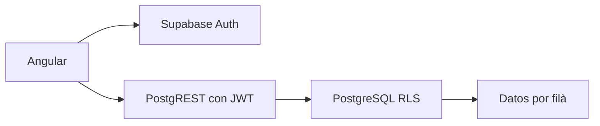

# Arquitectura y decisiones — fase 1

Angular 22 standalone, rutas diferidas por dominio, formularios reactivos y servicios tipados. Cada dominio mantiene sus servicios de datos y utilidades de validación; core contiene sesión, cliente de infraestructura y contratos compartidos. Los componentes coordinan formularios y presentación. Supabase Auth identifica personas; perfil, pertenencia y festero son conceptos separados. Ninguna clave de servicio llega al navegador. La configuración pública se carga en runtime.

Cada pertenencia vincula perfil y filà, opcionalmente con un festero. Los roles son por pertenencia. Administrador y junta gestionan festeros y familias; tesorero no obtiene permisos económicos ni de padrón. Festero consulta su ficha y dependientes con autorización vigente. Las modificaciones de permisos son exclusivas del administrador. La creación inicial de filà y administrador se realiza por un operador de confianza, nunca por registro público.

Las claves foráneas compuestas impiden relaciones entre filàs. RLS valida cada operación, además de los guards de UX. Las funciones de autorización tienen search_path fijo y consultan tablas fuera de la recursión de políticas. No hay borrado de festeros: se dan de baja. Los responsables deben ser adultos al inicio de la relación; los dependientes pueden ser adultos. Auditoría por triggers sin nombres, documentos o contactos completos.

No se implementan procesos económicos. Storage no se habilita: no hay documentos ni fotografías en esta fase, evitando superficie de acceso innecesaria. Exportación, anonimización y consentimientos quedan como servicios futuros sujetos a política de conservación y base jurídica.
