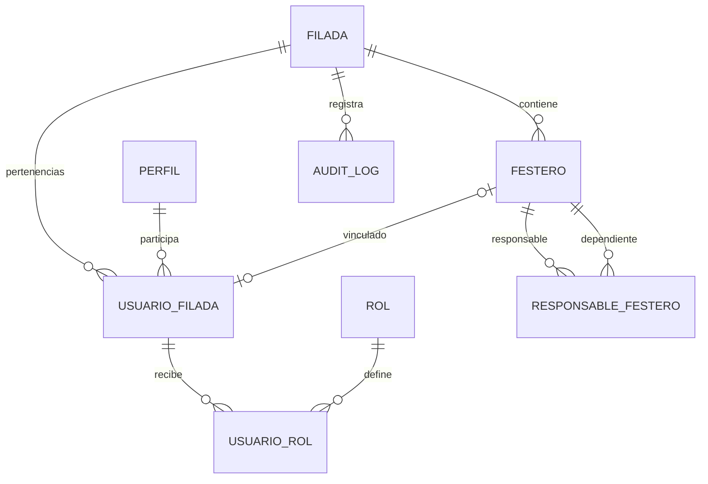

# Datos y migraciones

El esquema público usa nombres singulares en español. Todos los UUID se generan en PostgreSQL. `filada_id` es obligatorio en cada entidad de negocio; `perfil` representa una cuenta global y `rol` es un catálogo global de códigos, sin datos personales.



- `filada`: raíz y nombre de la organización.
- `perfil`: UUID de `auth.users`; un trigger lo crea al dar de alta la cuenta.
- `usuario_filada`: pertenencia; un usuario por filà y un festero vinculado por filà como máximo. No exige festero.
- `rol` / `usuario_rol`: roles extensibles por SQL y asignaciones por pertenencia. Roles nuevos no heredan derechos implícitos: añadirlos requiere definir sus permisos en migración y en la interfaz.
- `festero`: nombre, apellidos, documento opcional, nacimiento, contactos opcionales, alta/baja, estado, categoría y timestamps. No se persiste la minoría de edad.
- `responsable_festero`: relación N:M, tipo, autorización y vigencia inclusiva. El responsable debe tener 18 años al inicio. El dependiente puede ser adulto. No se exige cuenta a los menores. La autorización activa permite consulta; las modificaciones las realiza junta/administración en esta fase.
- `audit_log`: append-only para clientes, identificadores, actor, acción y fecha. No copia documentos, contactos, contraseñas ni fichas completas.

Las FK compuestas `(filada_id, id)` impiden vincular personas o pertenencias de otras filàs. CHECK verifica fechas, estados, tamaños y formato básico de contactos/documento. El documento no acredita identidad ni valida el dígito de control; es un identificador administrativo opcional. UNIQUE impide repetirlo dentro de una filà. Índices cubren pertenencias, roles, personas por filà/estado/apellidos, extremos familiares y auditoría.

## Operación

Las migraciones se aplican en orden desde `supabase/migrations`; nunca editar una migración ya desplegada. Crear una nueva para evolucionar el esquema. En local: `supabase start`; para reconstruir una base local desechable: `supabase db reset` (borra sus datos). En remoto: vincular explícitamente el proyecto y revisar `supabase db push --dry-run` antes de `supabase db push`.

El primer administrador requiere bootstrap por un operador de confianza. Crear primero su cuenta en Auth, con correo confirmado y contraseña segura o invitación; después, desde SQL Editor, ejecutar el siguiente bloque sustituyendo nombre y UUID. No existe endpoint público para autoconcederse una filà o rol.

```sql
begin;
-- Reemplazar el UUID por el de una cuenta real en Auth.
with nueva as (
 insert into public.filada(nombre) values ('Nombre de la filà') returning id
), pertenencia as (
 insert into public.usuario_filada(usuario_id, filada_id)
 select '00000000-0000-0000-0000-000000000000'::uuid, id from nueva
 returning id, filada_id
)
insert into public.usuario_rol(filada_id, usuario_filada_id, rol_codigo)
select filada_id, id, 'ADMINISTRADOR' from pertenencia;
commit;
```

Después, la administración puede vincular UUID de cuentas existentes a festeros y asignar/revocar roles en su filà. No se puede revocar el último administrador mediante una sesión de usuario. El alta de cuentas e invitación se gestiona con Supabase Auth por el operador; la clave `service_role` nunca se expone en Angular.

## Verificación

`npm run test:db` ejecuta la migración real en PostgreSQL embebido (PGlite) y simula los roles y el JWT de Supabase. Comprueba las políticas SQL, constraints y triggers; no sustituye la integración con GoTrue/PostgREST. `npm run test:e2e` añade esa integración contra Supabase local, con usuarios temporales de dos filàs. Los fixtures se eliminan al terminar y el runner rechaza URLs remotas.
